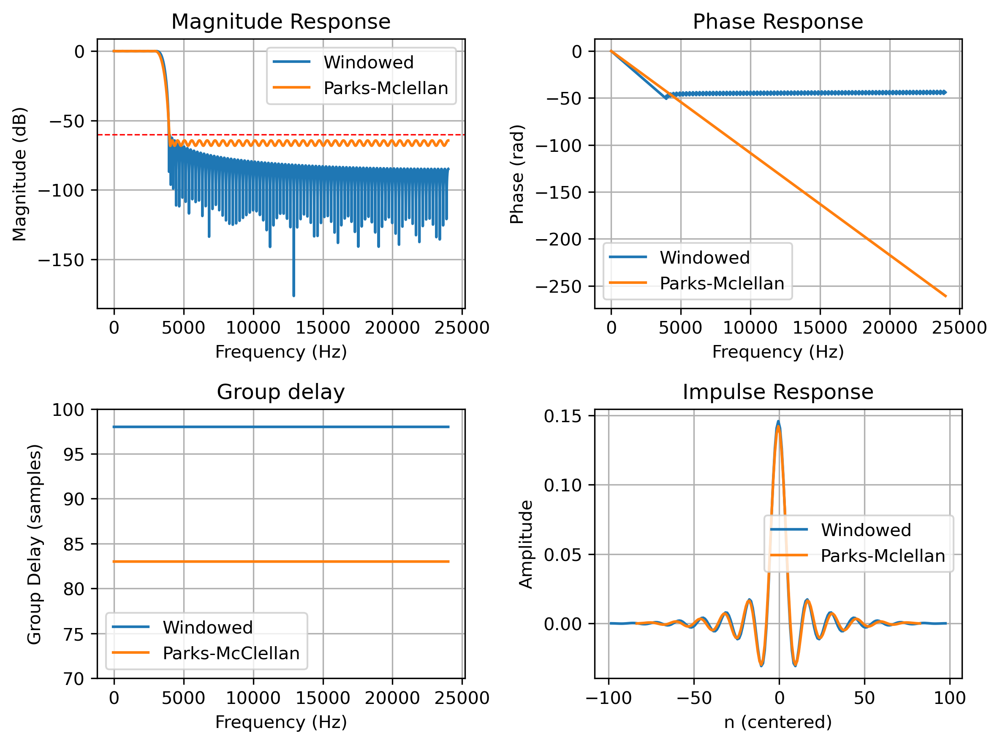

# Low-Pass FIR Filter: Python Design and Verilog Implementation

## Overview
A fixed-point lowpass FIR filter designed in Python and implemented in Verilog for an Artix-7 FPGA (Nexys A7-100T). The filter is designed using two methods (windowed-sinc and Parks-McClellan) and compared against a minimum-order elliptic IIR meeting the same spec. Both a serial single-MAC and a parallel transposed-form architecture were implemented and verified against a Python fixed-point reference across 126,000 samples. Note that the minimum order IIR filter was simply used for comparison, the hardware implementation solely focused on the FIR.

key results: The Parks-Mclellan FIR design met spec at 167 taps, while the windowed-sinc method met spec at 197 taps. Scaling the coefficients recovered ~12dB of stopband floor. the serial architecture uses 1 DSP48 at 169 cycles per sample while the parallel uses 167 DSP48s at 1 cycle per sample, both meeting timing at 100 MHz.

## Specification
48kHz sample rate, 3kHz passband edge, 4kHz stopband edge, 0.1dB passband ripple, 60 dB stopband attenuation.

## Results Tables

### Table 1 — Filter design comparison (floating point)

| | Windowed (Kaiser) | Equiripple (Parks–McClellan) | Elliptic IIR |
|---|---|---|---|
| Order / taps | 197 taps | 167 taps | Order 7 (4 biquads) |
| Coefficients stored | 197 | 167 | 20 |
| Multiplies per output sample | 197 | 167 | 20 |
| Passband ripple achieved |0.016dB |0.093dB |0.09dB |
| Worst stopband achieved |-60.26dB |-64.33dB |-61.00dB |
| Group delay | 98 samples (flat) | 83 samples (flat) | ~10–67 samples (varies) |
| Phase response | Linear | Linear | Nonlinear |
| Stability margin | N/A (all poles at origin) | N/A (all poles at origin) | max\|pole\| = 0.981 |
| Design method | Kaiser-windowed sinc, β = 5.65 | `scipy.signal.remez` | `ellipord` + `ellip`, SOS form |

### Table 2 — Hardware architecture comparison (Artix-7 XC7A100T-1)

| | Serial MAC | Parallel transposed |
|---|---|---|
| DSP48E1 | 1 |167 |
| LUTs |145 | 836|
| Flip-flops |94 |674 |
| Latency (cycles) | 169 | 3 |
| Throughput (cycles per sample) | 169 | 1 |
| Fmax before pipelining | 78 MHz | 72.7 MHz |
| Fmax after pipelining | ≥ 100 MHz | ≥ 100 MHz |
| Pre-fix critical path | Address generation into 658-fanout distributed RAM | 25 logic levels, multiply through rounding chain |
| Pipelining fix applied | Registered read address (`rd_idx_r`) | Registered accumulator output (`acc_r`) |
| Verification | 126,000 samples, 0 mismatches | 126,000 samples, 0 mismatches |

## Filter Responses

